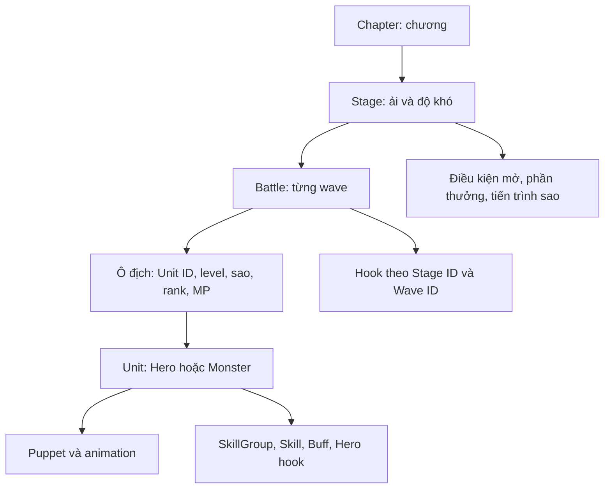

# Model Crystal và phạm vi prototype tiếp theo

Khảo sát ngày 19/11/2026. Đối chiếu [Design.md](../Design.md), đặc biệt D03, D05–D12. **Cập nhật mới nhất ở mục 7: mở rộng lên 16 Hero, giảm giới hạn xuống Xanh Dương, thêm wave, reset ải mỗi lần mở game và item có GUID, không stack.** Số liệu Tím+4 và đề xuất kho stack trong khảo sát ban đầu chỉ còn là tham chiếu lịch sử. Chưa sửa gameplay hoặc import asset.

## 1. Phạm vi và dữ liệu đã kiểm tra

Gốc Lua tham chiếu: `../Unity/Assets/Crystal Legend/recovered/scripts/lua/com.farlightgames.dgame.gp.apac/assets/remake/data/`.

- Đọc bảng Chapter, Stage, Battle, Unit, Puppet, hero_equip, UnitRank, equip, equipcraft, equipupgrade, enhancement, Loot, StageStarReward.
- Đối chiếu battle_engine.lua, stage.lua, unit.lua, skill.lua, unitawake.lua; hero.lua, ui/readhero.lua và UI chế tạo/phù phép.
- Đối chiếu common.proto, up.proto, down.proto trong thư mục `recovered/scripts/protobuf_utf8/.../assets/remake/data/`.
- Đối chiếu model, progression và config Zatod hiện có. Tài liệu Campaign cũ ghi 5 Hero demo; config hiện tại đã có 6 ID, gồm Berthaxe. Không dùng danh sách demo này thay cho đội khởi đầu Crystal.
- Kiểm tra sự tồn tại của summary/animation resource cho 5 Hero đề xuất và 22 loại địch bản Thường chương 1. Đây là kiểm tra dữ liệu đã giải mã, chưa phải xác nhận Hero chạy đúng trong Unity hay kiểm đủ mọi effect/audio phụ thuộc.

Báo cáo có schema và giá trị từng dòng: [source-audit.json](../Artifacts/CrystalLegendDesignReview/20261119/source-audit.json). Danh sách đủ 18 ải × 3 wave: [chapter1-normal-waves.md](../Artifacts/CrystalLegendDesignReview/20261119/chapter1-normal-waves.md).

## 2. Bộ 5 Hero để xác nhận

| Unit ID | Tên trong source | Cách gọi quen thuộc | Vị trí | Resource thực | Số action trong container |
|---|---|---|---|---|---|
| 1 | Coco | Thuyền trưởng/Kunkka | Trước | Coco_HD | 12 |
| 2 | DR | Drow Ranger/Traxex | Sau | DR | 12 |
| 3 | Lina | Lina | Giữa | Lina | 9 |
| 4 | Zeus | Zeus | Giữa | Zeus | 11 |
| 45 | Ench | Enchantress | Sau | Ench | 11 |

Đây là bộ 5 đang dùng làm ứng viên để xác nhận ý người dùng. Unit/Puppet/skill/Hero hook và asset của cả 5 đều có. Client không cung cấp đầy đủ backend tạo tài khoản, nên không khẳng định tài khoản mới nhận đồng thời cả 5 hoặc thứ tự nhận ở từng ải. Trận cinematic hướng dẫn 5v5 có đội khác và level 70; không lấy đội cinematic làm đội khởi đầu.

Lưu ý ánh xạ: Unit.Puppet của Coco là `Coco.cha`, nhưng Puppet.Resource là `Coco_HD`; không suy tên folder bằng cách bỏ `.cha`. Các folder reference nằm dưới `Unity/Assets/Crystal Legend/recovered/heroes/`.

Đủ dữ liệu đầu vào để chuyển bộ Hero cơ bản; việc import thành công còn phải nối đủ SkillGroup/Skill/Buff, timeline, projectile/region/chain, Hero hook, art và âm thanh. Không coi đủ file ảnh là đã hoàn tất Hero. Nhánh nâng cao như shard/skin/thức tỉnh trong hook cần lọc theo phạm vi, không kích hoạt mặc định.

## 3. Chương, ải, wave và quái trong Crystal

### Config tĩnh

| Bảng | Khóa và vai trò | Field chính |
|---|---|---|
| Chapter | Chapter ID | Chapter Name, Pre Chapter, Unlock Level |
| Stage | Stage ID; tham chiếu Chapter ID | Difficulty, Stage Group, tên/mô tả, Key Stage, Waves, Require Stage/Stars, Unlock Level, Daily Limit, Vitality Cost/Vit Return, Exp/Heroexp/Money Reward, UI reward1…10, MP Bonus, giới hạn/điều kiện bổ sung |
| Battle | Stage ID → Wave ID | Background Pic, H Flip, Stage Type/Skill ID; Monster 1…5 ID; từng ô có Level/Stars/Rank/MP/Money Reward/FD Bonus; multiplier HP/DPS/ARM/MR chung và riêng boss; Boss Position/Size |
| Unit | Unit ID, dùng chung cho Hero và Monster | Unit Type, stats/growth, Walk Speed, Collide Radius, Basic Skill, Script, Puppet, portrait và art |
| SkillGroup/Skill/Buff | Caster/skill ID và phase | Skill được mở, level scaling, chọn mục tiêu, delivery, timing, tác động/trạng thái |
| stage.lua | Stage ID → Wave ID → hàm | Ngoại lệ của từng đợt; có hành vi không nằm trong bảng Battle |
| Loot/equip/StageStarReward | Theo từng bảng | Thông tin loot, nơi kiếm item, thưởng mốc sao; UI reward không tự là xác suất drop |

Field `Monster Level` ở Stage phục vụ thông tin tổng quan; khi tạo từng địch, engine đọc `Level n` ở Battle. Không áp một level duy nhất cho cả ải. Ô có ID 0 là ô trống. Bảng Battle thường có 5 ô; engine dùng vòng lặp tổng quát tới 20 cho các chế độ khác, không có nghĩa mỗi wave chương 1 có 20 địch.

`Boss Position` chọn ô boss; cùng một Unit có thể xuất hiện ở phe địch với modifier boss. Không cần nhân bản toàn bộ định nghĩa Hero thành một định nghĩa quái mới chỉ vì đổi phe. Modifier 0 trong đường createOneMonster được hiểu là dùng mặc định, không phải nhân stat với 0. Boss modifier được nhân tiếp trên modifier chung. Đường tạo địch cũng có cờ ước lượng rank/skill; không xem Rank=0 là một bậc Trắng được chỉ định rõ.

### Chương 1 thực tế

- Chapter ID 1, tên `征途再启`, Pre Chapter 0, Unlock Level 1.
- Thường: Stage ID 1–18, 3 wave/ải → 54 wave; mỗi ải tốn 6 thể lực trong config.
- Tinh Anh: Stage ID 10001–10006, 3 wave/ải → 18 wave; tốn 12 thể lực/ải trong config.
- Có thêm 18 Stage Difficulty=4 trỏ Chapter ID 1. Không nhập chúng như các ải Thường hoặc tự mở rộng scope sang chế độ đó.
- Bản Thường dùng 22 Unit khác nhau: 10 Unit Type=Monster và 12 Unit Type=Hero. Cộng bộ 5 đề xuất thành 26 Unit riêng biệt vì Zeus đã có trong đội địch.
- 10 Monster: Treant, DOT, Ghoul, Necromancer, MeatWagon, CGjr, Goblinjr, SkeletonWarrior, SkeletonArcher, Golem.
- 12 Hero địch: Zeus, Lion, QOP, OK, TK, Sniper, Bone, Pugna, SNK, NEC, Tiny, Viper. Chỉ triển khai các nhánh skill thực sự dùng trong encounter; không mặc định cần toàn bộ nhánh endgame của 12 Hero này.

Ví dụ Stage 1:

| Wave | Các ô địch không trống | Chi tiết |
|---|---|---|
| 1 | Treant 101, DOT 102 | Level 1 |
| 2 | Treant 101 ×2, DOT 102 ×2 | Level 1 |
| 3 | Ghoul 104, SNK 19, Necromancer 105 | Level 1; ô 2 là boss, MP đầu 400 |

Cả 3 wave dùng `battle_bg/bbg_spring_HD3.jpg`. Modifier chung HP 35%, DPS 50%; wave 3 có Boss HP 128% nhân tiếp modifier HP chung. Số liệu này là config, không phải giả lập đã kiểm chứng trong Unity.

### Chuyển wave và ngoại lệ cần giữ

Luồng thường trong battle_engine.lua: thắng wave → nếu còn wave thì xử lý tiếp tế và chuyển Battle → hết wave mới kết thúc Stage và tính sao.

- Giữ các Unit phe người chơi qua resetBattle, không tạo lại đội full HP/full MP sau mỗi wave. Hero chết không được tự hồi sinh.
- battleSupply hồi HP bằng HPS và MP bằng MPS, có hệ số Mps Restraint; sau đó xử lý remove buff theo luật. Các buff không thể gỡ có xử lý riêng.
- setupBattle sắp lại vị trí, tạo địch mới và reset trạng thái action/skill; skill reset cooldown về Init CD. Không giữ nguyên mọi cooldown/buff một cách vô điều kiện.
- Đồng hồ wave thông thường được reset về 90 giây. Các mode đặc biệt có nhánh khác.
- Giao diện có bước Next; checker không hiển thị gọi nextBattle trực tiếp. Thời gian chờ UI không được tự trở thành thời gian chiến đấu.
- Hết Stage thường: số sao `max(1, 3 - số Hero chết)` nếu thắng. Các mode có điều kiện bổ sung phải xử lý theo mode.
- stage.lua có ngoại lệ trong chương đầu: Stage 1/2/3 wave 2 cộng 150 MP cho DR nếu có; Stage 1 wave 3 khóa ý định ulti thủ công của boss; Stage 6 wave 3 đặt MP boss=800; Stage 7 wave 3 đặt MP boss=950. Vì vậy chỉ nhập Battle rows là chưa đủ.

### Dữ liệu người chơi và dữ liệu trận

- Config không chứa sao người chơi đã đạt hay inventory thực tế.
- common.proto: Hero có `_tid`, `_rank`, `_level`, `_stars`, `_exp`, `_skill_levels`, `_items`; còn các nhánh fashion/shard/pet/astrolabe/legend equip tùy phạm vi.
- up.enter_stage gửi `_stage_id`; down.enter_stage_reply trả `_rseed` và `_loots`. Loot trả từ đầu có thông tin wave/ô quái/item, không chỉ là ảnh trang trí phía client.
- up.exit_stage chứa `_result`, `_stars`, `_heroes`, `_oprations` cùng dữ liệu kiểm chứng. Thưởng/tiến trình trong Zatod phải do server commit sau validate, không dựa riêng vào claim của client.
- Replay cần đủ đội đầu trận, dữ liệu/rules phiên bản, seed và thao tác theo tick để tái tạo cả chuỗi wave/hook. Không chỉ lưu replay riêng wave cuối.

## 4. Item và tiến bậc Crystal

### Các lớp dữ liệu

| Bảng/dữ liệu | Vai trò | Field chính |
|---|---|---|
| equip | Định nghĩa item; bản này có 1.320 dòng, gồm nhiều loại ngoài trang bị | Item_ID, Name, Category, Quality, Icon, Buy/Sell Price, Level Requirement, stats, các field +stat phù phép, Exp/Vitality/Consume Type, Drop/How To Get, Max Amount và field item đặc thù |
| hero_equip | Hero_ID → Quality (bậc Hero) | LvReq, Equip1…6 ID, EquipLevel, Init1…6 ID |
| equipcraft | Recipe tạo một item; 283 dòng | Item_ID đích, Expense, Rank, Category, Components, Component1…4 và Count tương ứng |
| enhancement | Quy tắc phù phép theo phẩm chất item | Max Level, giá/EXP từng mức, giá trị hoàn trả |
| equipupgrade | Đổi item trước → item sau | Item ID Before/After, Craft ID; 11 dòng trong bản này |
| UnitRank | Unit → Rank | Bộ stat bậc, bộ E.stat và GS để đường stat sử dụng; không phải danh sách item lịch sử |
| common.item | Item trong kho | `_id`, `_amount` |
| common.hero_equip | Item đang mặc trên Hero | `_index` (ô), `_item_id`, `_exp` (EXP phù phép/cường hóa) |

Hero rank và Quality của item là hai khái niệm khác nhau. Hero Tím+4 không có nghĩa mọi món đang mặc đều có một Quality tên Tím+4.

Recipe tham chiếu item khác nên có thể lồng nhiều tầng. Code UI chế tạo dùng `max(ComponentN Count or 1, 1)`; Count=0 với một component ID hợp lệ có nghĩa cần ít nhất 1, không phải miễn nguyên liệu.

Ví dụ recipe đã đọc:

- Item 391 `泰坦战斧`: 60 mảnh item 423 + 30.000 vàng.
- Item 422 `疾行鞋`: item 247 + 294 + 293 + 295, mỗi loại 1, cộng 18.000 vàng.

Phù phép là một cơ chế riêng, không phải tăng sao Hero. Dừng ở Tím+4 không tự buộc phải có phù phép, nhưng nếu muốn khớp chỉ số Crystal có phù phép thì cần model và quy tắc tương ứng. Không cộng vĩnh viễn bonus phù phép vào ledger hấp thụ khi chưa đối chiếu cách hoàn trả/tái tính của bản gốc.

### Chuỗi bậc

| Rank gốc | Tên |
|---|---|
| 1 | Trắng |
| 2–3 | Xanh Lá, Xanh Lá+1 |
| 4–6 | Xanh Dương, Xanh Dương+1, Xanh Dương+2 |
| 7–11 | Tím, Tím+1, Tím+2, Tím+3, Tím+4 |
| 12 | Cam |

Mỗi Hero trong bộ 5 có đủ config sáu ô cho các rank 1–11. Muốn từ Tím+3 lên Tím+4 phải mặc đủ bộ rank 10, rồi tiến bậc. Khi vừa vào rank 11 và khi đã mặc đầy đủ sáu món rank 11 là hai trạng thái khác nhau. Các row LvReq phản ánh yêu cầu của bộ trang bị ở bậc hiện tại; không tự diễn giải thành level để bước vào bậc đó.

Ví dụ Lina, bộ rank 11:

| Ô | Item ID | Tên gốc |
|---|---|---|
| 1 | 413 | 无尽长夜法杖 |
| 2 | 392 | 水晶球 |
| 3 | 414 | 翡翠之吻 |
| 4 | 346 | 虚灵 |
| 5 | 309 | 林肯 |
| 6 | 422 | 疾行鞋 |

Lina cần level 80 để mặc đủ bộ rank 10 theo config hiện có và tiến lên rank 11. Cả 5 Hero có thể mặc đầy đủ bộ Tím+4 ở level 80; đây không phải khẳng định mọi Hero đều phải level 80 mới vừa vào Tím+4 (ví dụ bộ rank 10 của Ench có mức yêu cầu tối đa 77).

Hợp tất cả loadout rank 1–11 của 5 Hero: 107 item ID trực tiếp; thêm toàn bộ nguyên liệu recipe đệ quy: 216 item ID. Không có tham chiếu item bị thiếu trong tập này. Đây là số loại item, không phải số lượng nguyên liệu cần để nâng 5 Hero. Không yêu cầu nhập toàn bộ 1.320 item.

### Giới hạn thức tỉnh của bản đang có

`battle/unitawake.lua` có canAwake và canSuperAwake trả false. Nhánh awakeLevelOk còn yêu cầu `_rank > 11` và `_level >= 90` nếu tính năng cho phép. Vì vậy Cam là ngưỡng bậc cần của nhánh đó, không phải cứ lên Cam là tự thức tỉnh; bản client này đang khóa tính năng. Dữ liệu nhiệm vụ/thức tỉnh còn tồn tại không chứng minh tính năng đang bật.

## 5. So với Zatod hiện tại

| Phần | Hiện có | Cần bổ sung cho phạm vi mới |
|---|---|---|
| Campaign config | Chapter → Stage → Monsters trực tiếp, 5 ải demo; điều kiện mở nối tuần tự | Wave, difficulty, unlock theo ID/sao/level, boss/per-slot level và modifier, nền, hook, reward/cost |
| Monster | Định nghĩa quái riêng, base stats và skill | Ánh xạ Unit/Hero làm địch, dữ liệu encounter tách khỏi config, tăng trưởng và stats tham chiếu |
| Hero rank | Chuỗi ID/NextRankId mở rộng được; dữ liệu thường mới có Trắng/Xanh Lá/Xanh Dương/Tím | Bổ sung các bậc trung gian và Tím+1…4 bằng ID ổn định; không suy bằng enum/index |
| Item | Id/Name/Stats; hiện 2 item | Loại/phẩm chất/icon/level, recipe, số lượng, các field cần cho stat conversion |
| Inventory | Có khai báo ItemStackData; chưa có giao dịch kho hoàn chỉnh | Cấp phát/tiêu hao, craft/equip/promote do server kiểm tra và lưu nguyên tử |
| Progression | Equip kiểm tra ô/ID; Promote chuyển vào AbsorbedItems | Ownership, tiêu hao kho, level gate, kết quả giao dịch; giữ ledger D08 |
| Growth | Có field Level/Stars/Exp, chưa đưa đủ tăng trưởng vào stat calculator | Chuyển tăng trưởng Crystal sang stat trực tiếp theo D05; không nâng level bằng con số mà stats đứng yên |
| Combat/network | Campaign server chạy live; Arena resolve rồi phát outcome; chưa PvP input sync | Shared simulator, input log/checker, replay từ input và tick sync theo D03 |

Các file đối chiếu: `Unity/Assets/Zatod/Heroes/CampaignDefinitions.cs`, `MonsterDefinitions.cs`, `HeroDefinitions.cs`, `HeroData.cs`, `HeroProgression.cs`; `ArenaNetwork/LiveCampaignConnection.cs`, `ArenaConnection.cs`; config `Resources/Data/`.

Giữ quyết định D08: Zatod lưu ID item thật đã hấp thụ, rồi tính lại bằng config hiện tại. Không cộng cả tổng UnitRank gốc lẫn cùng các món đã hấp thụ; cần quy đổi hoặc tách phần bonus độc lập, sau khi đối chiếu số liệu. Không thay model này chỉ để clone đúng cấu trúc save của Crystal.

## 6. Đề xuất để brainstorm, chưa chốt schema

### Phân lớp

- ChapterDefinition chứa thông tin chương và các Stage ID.
- StageDefinition chứa độ khó, điều kiện mở/cost/reward, các Wave ID có thứ tự.
- WaveDefinition chứa background, time limit, ô spawn và hook; MonsterSpawnDefinition tham chiếu Unit/Hero/Monster ID + level/rank/sao/MP/modifier. Hook có ID và tham số để dùng chung ở client/checker, không chứa thao tác Unity.
- StageProgressData lưu theo Stage ID: sao tốt nhất, đã clear, mốc thưởng đã nhận và bộ đếm cần thiết. Không nhúng tiến trình người chơi vào config.
- ItemDefinition, ItemRecipeDefinition, ItemStackData và EquippedItemData tách định nghĩa, công thức, số lượng kho và trạng thái mặc. Chỉ thêm enhancement state nếu phase chọn làm phù phép.
- BattleSession/initial data tách khỏi save Hero: mode, seed, config/rules version, stage/wave và đội hai bên. BattleInput/Replay dùng cùng bộ mô phỏng. Tên field cuối cùng chưa được duyệt.

### Các lựa chọn còn cần chốt

1. Xác nhận 5 Hero ứng viên và cấp đủ từ đầu hay mở dần qua ải. Đề xuất prototype cấp đủ để kiểm tra nhanh cả 3 mode.
2. Chương đầu chỉ Thường (18 ải/54 wave) hay thêm Tinh Anh (6 ải/18 wave). Đề xuất Thường trước, model có difficulty để bổ sung sau.
3. Chương đầu không cung cấp trọn chuỗi item cấp cao. Muốn test Tím+4 mà không làm các chương sau, đề xuất nguồn cấp nguyên liệu/vàng/EXP riêng cho prototype; vẫn craft/equip/promote qua giao dịch hợp lệ, không chỉ đổi RankId.
4. Chế tạo và kho có nằm trong vòng chơi phase này không; phù phép có thể để sau nếu người dùng chọn, nhưng không giả định đã đồng ý bỏ.
5. Quy tắc tăng trưởng level/sao trực tiếp, chuyển item STR/AGI/INT và kiểm tra tránh cộng đôi UnitRank/AbsorbedItems trước khi nhập balance.
6. Hoàn tất các quy tắc vận hành realtime: match/ready, đồng bộ input theo tick, input đến trễ, mất kết nối và kết thúc trận. Giữ Mirror; chưa tự thay transport/tick rate hay thêm rollback.

Định nghĩa hoàn thành đề xuất: cùng đầu vào và rules sinh cùng kết quả trên client/checker/replay; Phó bản đi hết các wave, validate mới commit thưởng; Arena tái hiện từ dữ liệu đầu trận; PvP chạy được hai client với input hai bên; 5 Hero có đủ animation/skill/effect trong phạm vi; một Hero tiến bậc thật đến Tím+4 bằng item. Đây là tiêu chí đề xuất để chốt, không phải báo cáo đã hoàn thành.

## 7. Cập nhật: giới hạn Xanh Dương, GUID và model quái

Các quyết định mới nằm ở D11/D12, thay thế đề xuất chưa chốt ở mục 6. Đây vẫn là lượt rà soát thiết kế, chưa triển khai wave, chuyển schema item hoặc hàm dev.

### Hero và quái dùng chung đến đâu?

Code hiện tại:

- HeroDefinition và MonsterDefinition cùng có tên/vị trí, BaseStats, normal attack, animation/prefab, spawn points, hurtbox và death timing. HeroDefinition có thêm Ranks/SkillSlots; MonsterDefinition dùng SkillIds trực tiếp.
- HeroData mô tả instance Hero sở hữu: level, sao, bậc, đồ đang mặc/hấp thụ, level skill. Quái wave không cần một hệ tiến trình sở hữu như vậy.
- HeroBattleData và MonsterBattleData đã kế thừa chung CombatantBattleData. Combat dùng FighterLoadout.Data để nhận phần chung; không cần viết một combat engine riêng cho quái.
- CampaignBattleFactory hiện chỉ spawn enemy bằng MonsterBattleFactory; cần cho ô wave tham chiếu cả Hero lẫn Monster. Hero ở phe địch tái sử dụng HeroDefinition và đường tính HeroBattleData; encounter cung cấp level/rank/sao/MP/modifier, không thêm một Hero mới vào HeroDesk của người chơi.

Hướng đã được người dùng đồng ý, chưa refactor: giữ HeroDefinition/HeroData/HeroBattleData và gom phần định nghĩa combat giống nhau vào base dùng chung CombatantDefinition, để MonsterDefinition chỉ giữ phần khác biệt. Giữ CombatantBattleData chung hiện có; không tạo thêm MonsterData dành cho sở hữu/nâng bậc của quái. Không dùng một HeroData sở hữu giả cho từng quái chỉ để đi qua validation rank/trang bị; không đổi toàn bộ tên class thành UnitDefinition.

Wave mới chứa các ô spawn có thứ tự, định nghĩa cần spawn, level/rank/sao/MP, boss và modifier. Cùng một loại quái có thể xuất hiện nhiều lần với BattleEntityId khác nhau; ID loại không được làm ID instance trận.

### Hook không đồng nghĩa tutorial

Hook là logic được gọi ở một Stage ID/Wave ID cụ thể. Stage 1/2/3 wave 2 cộng DR 150 MP và Stage 1 wave 3 khóa ý định ulti của boss có tác dụng hỗ trợ người chơi/điều phối trận đầu. Stage 6/7 wave 3 đặt boss 800/950 MP khiến boss có thể dùng skill sớm hơn. Không có bằng chứng để kết luận mọi hook đều nhằm làm dễ; giữ hành vi source, tách riêng overlay hướng dẫn nếu sau này cần.

### Phạm vi Hero và thống kê item mới

Tập Hero gồm Coco, DR, Lina, Zeus, Ench, Lion, QOP, OK, TK, Sniper, Bone, Pugna, SNK, NEC, Tiny, Viper: **16 Hero riêng biệt**. Có thêm 10 loại Monster. Zeus vừa thuộc bộ 5 vừa có ở phía địch nên chỉ đếm một lần. Các Unit của chương 1 Tinh Anh đã đối chiếu không bổ sung loại mới ngoài tập này; việc làm Tinh Anh vẫn chưa chốt.

Xanh Dương thường = rank 4, giữ rank 3 Xanh Lá+1 ở giữa. Skill mở tại Tím chưa được mở bằng tiến bậc trong giới hạn phase mới; không tự mở mọi skill cho cả đội.

| Phạm vi đếm cho cả 16 Hero | Item mặc trực tiếp khác nhau | Tổng loại item gồm nguyên liệu recipe đệ quy |
|---|---|---|
| Chỉ các bộ rank 1–3 để tiến vào Xanh Dương, chưa mặc bộ Xanh Dương | 51 | 73 |
| Rank 1–4, gồm đầy đủ sáu món ở Xanh Dương | 67 | 108 |
| Tham chiếu nếu sau này mở đến Xanh Dương+2 (rank 6), chưa phải scope đã chốt | 92 | 156 |

Tập chính 108 loại gồm 67 loại mặc trực tiếp và 41 loại nguyên liệu bổ sung; có 52 recipe trong phần phụ thuộc. Đây là số loại config. Nếu trang bị đủ sáu món ở cả bốn bậc cho toàn bộ 16 Hero thì có 384 lượt item trang bị thành phẩm (288 đã dùng trước khi vào Xanh Dương, 96 món của bộ Xanh Dương), chưa tính item nguyên liệu đã tiêu hao để craft. Không có nghĩa kho ban đầu phải chứa đúng 108 hoặc 384 món.

Báo cáo tái đếm: [blue-rank-item-audit.json](../Artifacts/CrystalLegendDesignReview/20261119/blue-rank-item-audit.json). Không sửa số liệu Tím+4 trong source-audit.json cũ vì đó là báo cáo của phạm vi trước.

### Instance item và hàm cấp đồ

Model trách nhiệm đã chốt, tên DTO cụ thể còn là đề xuất:

| Lớp | Dữ liệu tối thiểu |
|---|---|
| ItemDefinition | ItemId ổn định, tên, stats và các field config cần thiết |
| ItemData | Id: string GUID của món; ItemId: tham chiếu định nghĩa |
| Inventory | List<ItemData>; một phần tử là một món, không có Quantity để stack |
| Đồ đang mặc | SlotId và instance item/GUID đang chiếm ô; giữ nguyên Id khi mặc |
| Đồ đã hấp thụ | RankId, SlotId, ItemId và GUID món nguồn để ghi lịch sử; không còn là món có thể đem mặc/trade |

ItemDefinition hiện có Id string làm khóa loại; khi triển khai cần chuyển/ánh xạ rõ sang ItemId, không biến mọi khóa loại hiện có thành GUID instance. GUID không thay ItemId trong recipe/required slot hoặc cách balance config.

Đề xuất chữ ký hàm dev: AddItemByItemId(string itemId, int amount = 1). Thêm 3 món là tạo 3 ItemData với GUID khác nhau; ItemId phải resolve được. Nhánh dev cấp đồ thuộc nơi quản lý kho có thẩm quyền; GUID tạo khi cấp item, không sinh lại theo từng tick hoặc làm thay đổi RNG combat. Các thao tác mặc, craft và hấp thụ vẫn dùng cùng đường nghiệp vụ. Chưa xây Market/trade.

### Reset tiến trình phó bản

Chỉ giữ clear/unlock trong bộ nhớ của lần chơi; mở game lần mới quay về ải đầu. CampaignServerState hiện đọc lại replay archive để dựng cleared, nên khi triển khai cần bỏ việc khôi phục tiến trình cũ trong chế độ prototype này. Dedicated server có thể sống lâu hơn client: mở game lại phải tạo/reset phiên chơi phó bản tương ứng, không chỉ xóa UI phía client hoặc chờ server khởi động lại. Không xóa archive và không suy rộng yêu cầu này thành reset Hero, kho hay các loại dữ liệu khác.

### Hook chỉnh được để balance

Người dùng đồng ý giữ hook và muốn có thể tùy chỉnh để cân bằng ải; xem D13. Tham số (wave áp dụng, mục tiêu, lượng năng lượng, modifier/buff theo loại hook hỗ trợ) nằm trong config/Editor; handler thực thi nằm trong core chung. Có thể chỉnh tham số mà không sửa code, còn cơ chế chưa có cần handler mới. Dữ liệu ban đầu giữ hành vi Crystal. Schema cụ thể chưa chốt và chưa có Editor hook.

Những điểm cần chốt tiếp, không tự coi là yêu cầu đã duyệt:

- Quy đổi đóng góp/tăng trưởng STR/AGI/INT thành stat trực tiếp, xử lý chênh lệch do Main Attrib và tránh cộng đôi UnitRank/item hấp thụ. Không chỉ loại các cột khỏi JSON.
- Level Hero/skill và sao cho thử nghiệm: một số món bộ Xanh Dương yêu cầu level 35–37; chỉ cấp item không đủ nếu Hero không đạt điều kiện. Công cụ dev chỉnh level/skill hoặc cấp EXP là đề xuất bổ sung, chưa được yêu cầu triển khai.
- Tick/clock, làm tròn và thứ tự xử lý input đồng thời; chính sách PvP input trễ/mất kết nối; cách lưu bộ dữ liệu/rules theo trận/replay. Các chi tiết này phải giữ kết quả nhất quán giữa client/checker.
- Phạm vi Tinh Anh, chế tạo và phù phép vẫn chưa chốt. Import 108 loại item không tự đồng nghĩa đã duyệt toàn bộ UI/nghiệp vụ các hệ thống này.

### Chốt phạm vi: cấp thẳng item, hoãn craft

Theo chỉ dẫn tiếp theo ngày 19/11/2026, công cụ test được bổ sung dần. Phase hiện tại dùng hàm dev cấp trực tiếp item đích theo ItemId, mỗi món một GUID; không cần craft món thấp thành món cao hoặc kiểm tra nguyên liệu/phí craft. Mặc đồ và tiến bậc vẫn dùng điều kiện bình thường.

Vì vậy tập cần cho cấp đồ/trang bị hiện tại là 67 loại item trực tiếp của 16 Hero đến Xanh Dương; 41 loại nguyên liệu bổ sung trong tập 108 là tham chiếu cho craft tương lai, chưa cần nhập chỉ để phục vụ recipe. Không làm craft, phù phép, Tinh Anh hoặc các hệ thống phụ trong phase này.

Rule mạng/combat trước mắt giữ theo phần Crystal đã xác nhận từ source; chưa tự cải tiến input trễ/mất kết nối. Không gắn nhãn một chính sách backend chưa biết là rule Crystal. Những đề xuất bổ sung công cụ và mở rộng hệ thống ở các mục trước đã được thu hẹp theo D03/D11/D12. Chưa viết hàm cấp đồ hoặc sửa runtime ở lượt chốt thiết kế này.
